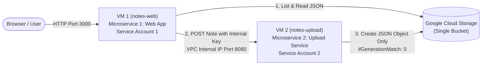

# Cloud Notes App Using Google Cloud Storage, Docker, and Microservices

A production-grade, secure, multi-tier cloud notes application built with **Node.js/Express**, **Google Cloud Storage (GCS)**, **Docker containers**, and **Google Compute Engine (GCE)**.

---

## 1. Architecture Overview

The system strictly decouples the user-facing web dashboard from the data ingestion layer using two independent microservices running on separate Compute Engine virtual machines with strictly enforced Google Cloud IAM least-privilege permissions.



### Core Architectural Principles

1. **Exactly One GCS Bucket**: Both microservices interact with the same bucket (`gs://<YOUR_BUCKET_NAME>/notes/*.json`).
2. **Exactly Two Microservices & Containers**:
   - `microservice-1-web`: Serves the responsive web UI and fetches saved notes.
   - `microservice-2-upload`: Validates incoming note payloads and writes unique JSON objects to GCS.
3. **Strict Least-Privilege IAM**:
   - **Service Account 1 (Notes Reader - VM 1)**: Attached to VM 1. Only has `storage.objects.get` and `storage.objects.list`. It **CANNOT** create, update, overwrite, or delete objects.
   - **Service Account 2 (Notes Uploader - VM 2)**: Attached to VM 2. Only has `storage.objects.create`. It **CANNOT** list, read, update, overwrite, or delete objects.
4. **Zero Direct Writes from Microservice 1**: Microservice 1 possesses neither the code nor the IAM permissions to write to Cloud Storage. Every note creation must traverse the internal network to Microservice 2.
5. **No Long-Lived Service Account Keys**: Authentication uses **Application Default Credentials (ADC)** derived automatically from each VM's attached service account.

---

## 2. Project Directory Structure

```text
ccNotes/
├── microservice-1-web/
│   ├── public/
│   │   ├── index.html          # Modern, responsive web interface
│   │   ├── style.css           # Clean CSS styling (Google Cloud palette)
│   │   └── app.js              # Client-side JavaScript (AJAX & UI state)
│   ├── server.js               # Express server: GET /api/notes, POST proxy
│   ├── package.json            # Node.js dependencies for Microservice 1
│   ├── Dockerfile              # Docker container configuration for VM 1
│   ├── .dockerignore           # Excluded files during Docker build
│   └── .env.example            # Environment variables template
├── microservice-2-upload/
│   ├── server.js               # Express server: POST /api/notes (write-only)
│   ├── package.json            # Node.js dependencies for Microservice 2
│   ├── Dockerfile              # Docker container configuration for VM 2
│   ├── .dockerignore           # Excluded files during Docker build
│   └── .env.example            # Environment variables template
├── test-e2e.js                 # Complete local automated test suite
├── package.json                # Root package runner
└── README.md                   # Comprehensive deployment & verification guide
```

---

## 3. Storage Data Format

Notes are stored as individual JSON files in the bucket under the `notes/` prefix:

- Object name: `notes/<uuid>.json` (e.g. `notes/6bf26588-4c27-46ee-8df3-575bf3aa4f72.json`)
- Payload schema:

```json
{
  "id": "6bf26588-4c27-46ee-8df3-575bf3aa4f72",
  "title": "Architecture Review Notes",
  "content": "VM 1 reads notes while VM 2 uploads notes.",
  "created_at": "2026-10-16T06:00:00.000Z"
}
```

---

## 4. Local Testing Before Deployment

You can test the entire workflow locally without deploying to GCP first. The project includes a mock storage engine (`MOCK_STORAGE=true`) and an automated test suite.

### Run Automated End-to-End Tests:

```powershell
npm test
```

This script spins up both microservices on separate ports, executes 11 unit & integration tests (health check, unauthorized access, least privilege method restrictions, input validation, forwarding, and retrieval), and cleanly stops the servers.

---

## 5. Google Cloud Setup: Step-by-Step Instructions

Follow these exact steps in the [Google Cloud Console](https://console.cloud.google.com/) or use the equivalent `gcloud` CLI commands below.

### Step 5.1: Create the Cloud Storage Bucket

#### Console Steps:
1. Open **Cloud Storage** > **Buckets** in the Google Cloud Console.
2. Click **Create**.
3. **Name your bucket**: Enter a globally unique name, e.g. `cloud-notes-bucket-[PROJECT_ID]`.
4. **Location type**: Choose `Region` and select your preferred region (e.g., `us-central1`).
5. **Storage class**: Choose `Standard`.
6. **Access control**: Choose **Enforce public access prevention on this bucket** and select **Uniform** access control.
7. Click **Create**.

---

### Step 5.2: Create Custom IAM Roles (Least Privilege)

#### Console Steps:
1. Go to **IAM & Admin** > **Roles**.
2. Click **+ Create Role**:
   - **Title**: `Notes Reader Role`
   - **ID**: `notesReaderRole`
   - **Role launch stage**: `General Availability`
   - Click **+ Add Permissions** and add:
     - `storage.objects.get`
     - `storage.objects.list`
   - Click **Create**.
3. Click **+ Create Role** again:
   - **Title**: `Notes Uploader Role`
   - **ID**: `notesUploaderRole`
   - **Role launch stage**: `General Availability`
   - Click **+ Add Permissions** and add:
     - `storage.objects.create`
   - Click **Create**.

---

### Step 5.3: Create Dedicated Service Accounts

#### Console Steps:
1. Go to **IAM & Admin** > **Service Accounts**.
2. Click **+ Create Service Account**:
   - **Service account name**: `sa-notes-reader`
   - **Service account ID**: `sa-notes-reader`
   - **Description**: Service account for VM 1 (Cloud Notes Web App)
   - Click **Create and Continue**, then click **Done**.
3. Click **+ Create Service Account** again:
   - **Service account name**: `sa-notes-uploader`
   - **Service account ID**: `sa-notes-uploader`
   - **Description**: Service account for VM 2 (Cloud Notes Upload Service)
   - Click **Create and Continue**, then click **Done**.

---

### Step 5.4: Bind IAM Permissions to the Bucket

#### Console Steps:
1. Go to **Cloud Storage** > **Buckets** and click on your bucket.
2. Select the **Permissions** tab and click **Grant Access**:
   - **New principals**: `sa-notes-reader@[PROJECT_ID].iam.gserviceaccount.com`
   - **Role**: Select your custom role `Notes Reader Role` (or `Storage Object Viewer`).
   - Click **Save**.
3. Click **Grant Access** again:
   - **New principals**: `sa-notes-uploader@[PROJECT_ID].iam.gserviceaccount.com`
   - **Role**: Select your custom role `Notes Uploader Role` (or `Storage Object Creator`).
   - Click **Save**.

---

### Step 5.5: Configure VPC Firewall Rules

#### Console Steps:
1. Go to **VPC Network** > **Firewall**.
2. Click **Create Firewall Rule** for Web App (VM 1):
   - **Name**: `allow-notes-web`
   - **Network**: `default`
   - **Targets**: `Specified target tags`
   - **Target tags**: `notes-web`
   - **Source filter**: `IPv4 ranges`
   - **Source IPv4 ranges**: `0.0.0.0/0`
   - **Protocols and ports**: Specified protocols and ports > Check `TCP` > enter `3000` (or `80`).
   - Click **Create**.
3. Click **Create Firewall Rule** for Upload Service (VM 2):
   - **Name**: `allow-notes-upload-from-web`
   - **Network**: `default`
   - **Targets**: `Specified target tags`
   - **Target tags**: `notes-upload`
   - **Source filter**: `Source tags`
   - **Source tags**: `notes-web` *(Allows traffic only from VM 1)*
   - **Protocols and ports**: Specified protocols and ports > Check `TCP` > enter `8080`.
   - Click **Create**.

---

### Step 5.6: Launch the Compute Engine Virtual Machines

#### VM 1 — Web Application
1. Go to **Compute Engine** > **VM instances** > Click **Create Instance**.
2. **Name**: `vm-notes-web`
3. **Region / Zone**: Same as your bucket (e.g., `us-central1-a`).
4. **Machine configuration**: `e2-micro` or `e2-small`.
5. **Boot disk**: `Ubuntu 22.04 LTS` or `Debian 12`.
6. Under **Identity and API access**:
   - **Service account**: Select `sa-notes-reader@[PROJECT_ID].iam.gserviceaccount.com`.
   - **Access scopes**: `Allow full access to all Cloud APIs` (IAM roles restrict actual access).
7. Under **Networking** > **Network tags**: Add `notes-web`.
8. Click **Create**.

#### VM 2 — Upload Service
1. In **VM instances**, click **Create Instance**.
2. **Name**: `vm-notes-upload`
3. **Region / Zone**: Same region and zone (e.g., `us-central1-a`).
4. **Machine configuration**: `e2-micro` or `e2-small`.
5. **Boot disk**: `Ubuntu 22.04 LTS` or `Debian 12`.
6. Under **Identity and API access**:
   - **Service account**: Select `sa-notes-uploader@[PROJECT_ID].iam.gserviceaccount.com`.
   - **Access scopes**: `Allow full access to all Cloud APIs` (IAM roles restrict actual access).
7. Under **Networking** > **Network tags**: Add `notes-upload`.
8. Click **Create**.

---

### Quick Setup: Google Cloud CLI (`gcloud`) Commands

If you prefer using the Cloud Shell or terminal, run this equivalent script:

```bash
# Set your variables
export PROJECT_ID=$(gcloud config get-value project)
export REGION="us-central1"
export ZONE="us-central1-a"
export BUCKET_NAME="cloud-notes-bucket-${PROJECT_ID}"
export INTERNAL_API_KEY="notes-secure-shared-key-2026"

# 1. Create Bucket
gcloud storage buckets create gs://${BUCKET_NAME} \
  --project=${PROJECT_ID} \
  --location=${REGION} \
  --uniform-bucket-level-access

# 2. Create Custom IAM Roles
gcloud iam roles create notesReaderRole \
  --project=${PROJECT_ID} \
  --title="Notes Reader Role" \
  --permissions=storage.objects.get,storage.objects.list \
  --stage=GA

gcloud iam roles create notesUploaderRole \
  --project=${PROJECT_ID} \
  --title="Notes Uploader Role" \
  --permissions=storage.objects.create \
  --stage=GA

# 3. Create Service Accounts
gcloud iam service-accounts create sa-notes-reader \
  --display-name="Notes Reader Service Account (VM 1)"

gcloud iam service-accounts create sa-notes-uploader \
  --display-name="Notes Uploader Service Account (VM 2)"

# 4. Bind Roles on the Bucket
gcloud storage buckets add-iam-policy-binding gs://${BUCKET_NAME} \
  --member="serviceAccount:sa-notes-reader@${PROJECT_ID}.iam.gserviceaccount.com" \
  --role="projects/${PROJECT_ID}/roles/notesReaderRole"

gcloud storage buckets add-iam-policy-binding gs://${BUCKET_NAME} \
  --member="serviceAccount:sa-notes-uploader@${PROJECT_ID}.iam.gserviceaccount.com" \
  --role="projects/${PROJECT_ID}/roles/notesUploaderRole"

# 5. Create Firewall Rules
gcloud compute firewall-rules create allow-notes-web \
  --network=default \
  --allow=tcp:3000 \
  --target-tags=notes-web \
  --source-ranges=0.0.0.0/0 \
  --description="Allow public access to Cloud Notes Web App"

gcloud compute firewall-rules create allow-notes-upload-from-web \
  --network=default \
  --allow=tcp:8080 \
  --target-tags=notes-upload \
  --source-tags=notes-web \
  --description="Allow VM 1 to access Upload Service on VM 2"

# 6. Create Virtual Machines
gcloud compute instances create vm-notes-web \
  --zone=${ZONE} \
  --machine-type=e2-micro \
  --image-family=ubuntu-2204-lts \
  --image-project=ubuntu-os-cloud \
  --tags=notes-web \
  --service-account=sa-notes-reader@${PROJECT_ID}.iam.gserviceaccount.com \
  --scopes=cloud-platform

gcloud compute instances create vm-notes-upload \
  --zone=${ZONE} \
  --machine-type=e2-micro \
  --image-family=ubuntu-2204-lts \
  --image-project=ubuntu-os-cloud \
  --tags=notes-upload \
  --service-account=sa-notes-uploader@${PROJECT_ID}.iam.gserviceaccount.com \
  --scopes=cloud-platform
```

---

## 6. Docker Build and Container Run Commands

### 6.1: Deploy Microservice 2 on VM 2 (`vm-notes-upload`)

1. SSH into VM 2:
   ```bash
   gcloud compute ssh vm-notes-upload --zone=us-central1-a
   ```
2. Install Docker (if not pre-installed):
   ```bash
   sudo apt-get update
   sudo apt-get install -y docker.io git
   sudo usermod -aG docker $USER
   newgrp docker
   ```
3. Copy or clone the project repository, and navigate to `microservice-2-upload`:
   ```bash
   cd ccNotes/microservice-2-upload
   ```
4. Build the Docker image:
   ```bash
   docker build -t cloud-notes-upload:v1 .
   ```
5. Run the container:
   ```bash
   docker run -d \
     --name upload-service \
     --restart unless-stopped \
     -p 8080:8080 \
     -e PORT=8080 \
     -e BUCKET_NAME="<YOUR_BUCKET_NAME>" \
     -e INTERNAL_API_KEY="<YOUR_INTERNAL_API_KEY>" \
     cloud-notes-upload:v1
   ```
6. Check logs:
   ```bash
   docker logs -f upload-service
   ```
7. Find VM 2's Internal IP address:
   ```bash
   hostname -I
   ```
   *(Save this internal IP address, e.g. `10.128.0.3`)*

---

### 6.2: Deploy Microservice 1 on VM 1 (`vm-notes-web`)

1. SSH into VM 1:
   ```bash
   gcloud compute ssh vm-notes-web --zone=us-central1-a
   ```
2. Install Docker:
   ```bash
   sudo apt-get update
   sudo apt-get install -y docker.io git
   sudo usermod -aG docker $USER
   newgrp docker
   ```
3. Copy or clone the project repository, and navigate to `microservice-1-web`:
   ```bash
   cd ccNotes/microservice-1-web
   ```
4. Build the Docker image:
   ```bash
   docker build -t cloud-notes-web:v1 .
   ```
5. Run the container (replace `VM2_INTERNAL_IP` with VM 2's actual internal IP):
   ```bash
   docker run -d \
     --name web-service \
     --restart unless-stopped \
     -p 3000:3000 \
     -e PORT=3000 \
     -e BUCKET_NAME="<YOUR_BUCKET_NAME>" \
     -e UPLOAD_SERVICE_URL="http://<VM2_INTERNAL_IP>:8080" \
     -e INTERNAL_API_KEY="<YOUR_INTERNAL_API_KEY>" \
     cloud-notes-web:v1
   ```
6. Check logs:
   ```bash
   docker logs -f web-service
   ```

---

## 7. Complete Verification Checklist & IAM Testing Commands

Log in to the respective VMs to perform the mandatory permission and functional tests.

### Checklist Item 1 & 2: Verify Web App & Health Endpoints
From your local browser, visit:
```text
http://<VM1_EXTERNAL_IP>:3000
```
- Verify the dashboard displays cleanly.
- Check health:
  ```bash
  curl http://<VM1_EXTERNAL_IP>:3000/health
  ```
  Output: `{"status":"ok","service":"cloud-notes-web-service",...}`

### Checklist Item 3 & 4: Submit a Note
- Fill in the Title and Content in the web UI and click **Save Note**.
- Verify that the notification banner displays green success.
- Verify the new note card appears on the screen with its unique ID badge and timestamp.

### Checklist Item 5: GCS Bucket Verification
From Cloud Shell or any authorized machine:
```bash
gcloud storage ls gs://<YOUR_BUCKET_NAME>/notes/
```
The newly created JSON object is present.

### Checklist Item 6 & 7: Test IAM Permissions on VM 1 (Reader Service Account)
SSH into VM 1 (`vm-notes-web`):

**Allowed Operation (List & Read Objects):**
```bash
# 1. Listing objects (MUST SUCCEED)
gcloud storage ls gs://<YOUR_BUCKET_NAME>/notes/

# 2. Reading an object (MUST SUCCEED)
gcloud storage cat gs://<YOUR_BUCKET_NAME>/notes/<NOTE_ID>.json
```

**Denied Operations (Upload & Delete Objects):**
```bash
# 3. Attempting to create an object directly (MUST FAIL with 403 Forbidden)
echo '{"title":"Unauthorized"}' | gcloud storage cp - gs://<YOUR_BUCKET_NAME>/notes/hacker.json

# Expected Output:
# AccessDeniedException: 403 Caller does not have storage.objects.create access to the Google Cloud Storage object.

# 4. Attempting to delete an object (MUST FAIL with 403 Forbidden)
gcloud storage rm gs://<YOUR_BUCKET_NAME>/notes/<NOTE_ID>.json

# Expected Output:
# AccessDeniedException: 403 Caller does not have storage.objects.delete access to the Google Cloud Storage object.
```

---

### Checklist Item 8, 9 & 10: Test IAM Permissions on VM 2 (Uploader Service Account)
SSH into VM 2 (`vm-notes-upload`):

**Allowed Operation (Create New Object):**
```bash
# Creating a new object (MUST SUCCEED)
echo '{"test":"direct-upload"}' | gcloud storage cp - gs://<YOUR_BUCKET_NAME>/notes/manual-test.json
```

**Denied Operations (List, Read, Overwrite, Delete):**
```bash
# 1. Attempting to list objects (MUST FAIL with 403 Forbidden)
gcloud storage ls gs://<YOUR_BUCKET_NAME>/notes/

# Expected Output:
# AccessDeniedException: 403 Caller does not have storage.objects.list access to the Google Cloud Storage bucket.

# 2. Attempting to read an existing note (MUST FAIL with 403 Forbidden)
gcloud storage cat gs://<YOUR_BUCKET_NAME>/notes/manual-test.json

# Expected Output:
# AccessDeniedException: 403 Caller does not have storage.objects.get access to the Google Cloud Storage object.

# 3. Attempting to overwrite an existing object (MUST FAIL with 403 Forbidden)
echo '{"test":"overwrite-attempt"}' | gcloud storage cp - gs://<YOUR_BUCKET_NAME>/notes/manual-test.json

# Expected Output:
# AccessDeniedException: 403 Caller does not have storage.objects.update or storage.objects.delete access.

# 4. Attempting to delete an object (MUST FAIL with 403 Forbidden)
gcloud storage rm gs://<YOUR_BUCKET_NAME>/notes/manual-test.json

# Expected Output:
# AccessDeniedException: 403 Caller does not have storage.objects.delete access to the Google Cloud Storage object.
```

---

### Checklist Item 11: Validation Test
Test submitting invalid data:
```bash
curl -X POST http://<VM1_EXTERNAL_IP>:3000/api/notes \
  -H "Content-Type: application/json" \
  -d '{"title":"", "content":""}'
```
Expected output:
```json
{"error":"Validation Error","message":"Note title is required and cannot be blank."}
```

---

### Checklist Item 12: Network & Auth Restriction Test
Attempt to access Microservice 2 from unauthorized hosts or without the `x-api-key`:
```bash
curl -X POST http://<VM2_INTERNAL_IP>:8080/api/notes \
  -H "Content-Type: application/json" \
  -d '{"title":"Test","content":"Test"}'
```
Expected output:
```json
{"error":"Unauthorized","message":"Access denied: Invalid or missing internal API key"}
```
Additionally, verify that attempts from the public Internet to reach `<VM2_EXTERNAL_IP>:8080` time out because the VPC firewall rule restricts port 8080 exclusively to VM 1 (`notes-web`).

---

### Checklist Item 13: Container Isolation
Verify with `docker ps` on both VMs that both containers run independently and restart automatically:
```bash
docker ps
```
Restarting VM 1 or its container does not disrupt VM 2, and restarting VM 2 does not stop VM 1 from serving cached web assets.
